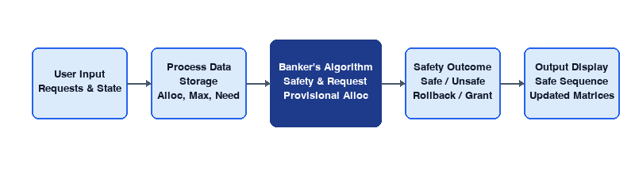
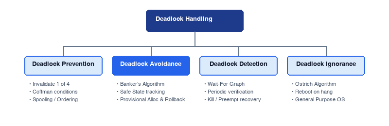
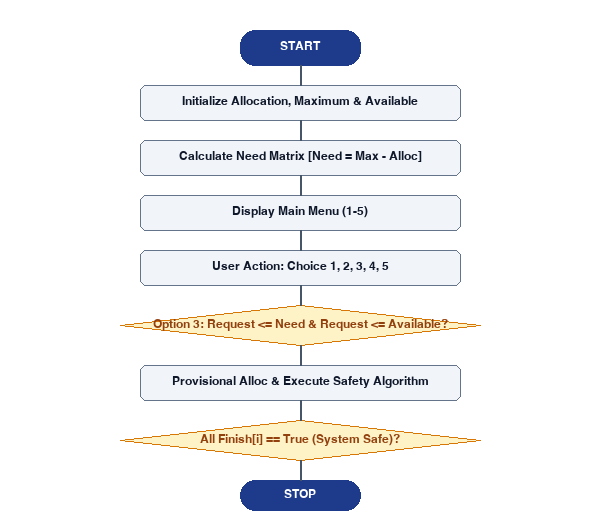
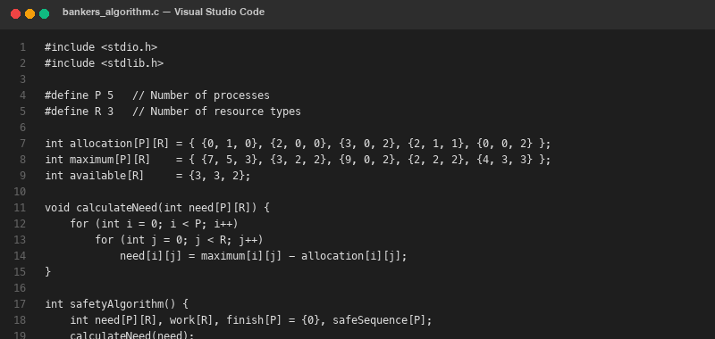
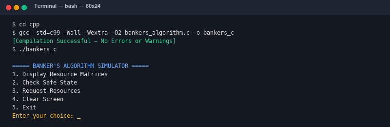
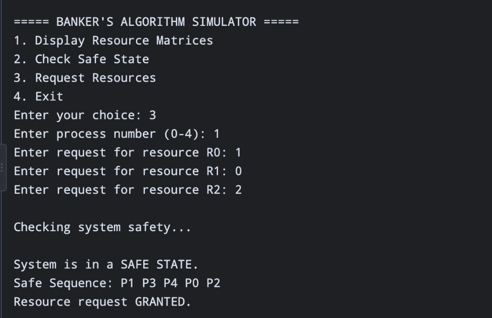
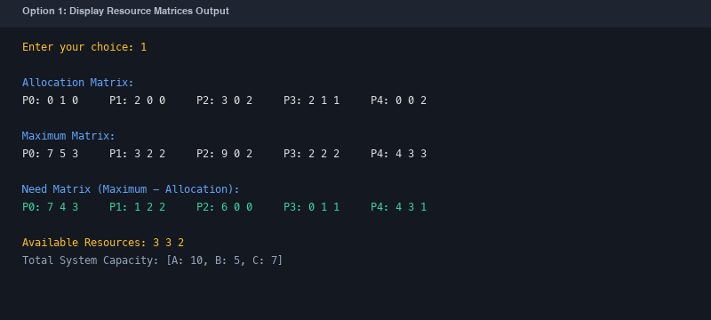
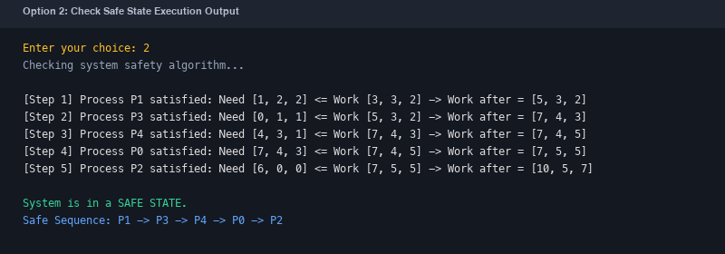

# SYMBIOSIS INSTITUTE OF TECHNOLOGY, HYDERABAD
### Symbiosis International (Deemed University), Pune
*(Established under section 3 of the UGC Act, 1956 | Re-Accredited by NAAC with ‘A++’ Grade | Awarded Category – I by UGC)*

---

# OPERATING SYSTEMS
## MINI PROJECT REPORT

| Metadata Field | Details |
| :--- | :--- |
| **Course Name** | Operating Systems (CSE-301) |
| **Mini Project Title** | Banker's Algorithm for Deadlock Avoidance Simulator |
| **Student Name(s)** | 1. Avignya Reddy Jakku<br>2. Aapti Erragunta<br>3. Ahila Meghana<br>4. Krithika Reddy |
| **PRN / Roll Number(s)** | 1. `25070721024`<br>2. `25070721018`<br>3. `25070721002`<br>4. `25070721062` |
| **Faculty Guide** | Dr. Bibhuprasad Sahu |
| **Academic Year** | 2026 |
| **Semester** | 3rd Semester |
| **Section** | Batch-1 |

---

## ACKNOWLEDGEMENT

We would like to express our sincere gratitude to our Operating Systems faculty guide **Dr. Bibhuprasad Sahu** for providing valuable guidance, continuous support and encouragement throughout the development of this mini project. His suggestions and feedback helped us understand the concepts of deadlock avoidance, resource-allocation graphs, and Dijkstra's Banker's Algorithm and improve our implementation.

We extend our heartfelt thanks to the Head of the Department **Dr. Suryanarayana** and the Department of Computer Science and Engineering for providing us with the opportunity, resources and facilities required to complete this project successfully.

We are also grateful to our institute, **Symbiosis Institute of Technology (SIT), Hyderabad**, for providing a supportive learning environment and access to the necessary software tools and laboratory facilities.

This project helped us strengthen our knowledge of operating system concepts, C programming, process management, dynamic resource allocation and deadlock avoidance algorithms. We would also like to thank our classmates and friends for their valuable suggestions, discussions and support during the development and testing phases.

---

## ABSTRACT

Deadlock is a critical state in multi-programming operating systems where concurrent processes are permanently blocked from execution because each process holds resources while waiting for resources currently held by others in a circular dependency. Deadlock avoidance is an active strategy that ensures the operating system never transitions from a safe state to an unsafe state where deadlock could occur.

This mini project develops a menu-driven **Banker's Algorithm Simulator for Deadlock Avoidance** using the C programming language. The simulator models a multi-process, multi-resource system featuring $n = 5$ processes ($P_0$ to $P_4$) and $m = 3$ resource types ($R_0, R_1, R_2$). It implements the complete Banker's safety verification algorithm and dynamic resource-request evaluation logic.

The user interacts with a clean console interface allowing them to display allocation matrices, execute the safety algorithm to determine if a safe execution sequence exists, and dynamically request resources for any process. The system computes the Need matrix ($\text{Need}[i][j] = \text{Maximum}[i][j] - \text{Allocation}[i][j]$) and validates incoming requests against maximum claims and available capacities. A provisional allocation is performed, followed by safety verification using a Work vector. If the resulting state remains safe, the request is permanently granted; if unsafe, the system executes an immediate state rollback and orders the process to wait.

The project uses arrays, functions, loops, conditional statements and temporary state vectors to simulate resource distribution and ensure robust error handling against negative inputs and invalid process indices. The simulator is an educational model that provides students with practical insight into how conservative resource-allocation policies prevent deadlock in operating systems without incurring runtime process termination.

---

## TABLE OF CONTENTS

1. [Introduction](#1-introduction)
2. [Problem Statement and Objectives](#2-problem-statement-and-objectives)
3. [Literature / Existing System](#3-literature--existing-system)
4. [Requirements and Tools](#4-requirements-and-tools)
5. [System Design / Methodology](#5-system-design--methodology)
6. [Implementation](#6-implementation)
7. [Testing and Results](#7-testing-and-results)
8. [Discussion](#8-discussion)
9. [Conclusion and Future Scope](#9-conclusion-and-future-scope)
10. [References](#10-references)
- [Appendix A – Sample Input & System Allocation State](#appendix-a--sample-input--system-allocation-state)
- [Appendix B – Source Code Submission](#appendix-b--source-code-submission)

---

## 1. INTRODUCTION

### 1.1 Background
An operating system manages computer hardware and system resources, providing an environment in which application programs execute efficiently. A process is a program in execution. In a multi-programming or multi-tasking system, multiple processes compete for a finite set of shared system resources such as CPU cycles, memory partitions, I/O devices, files, and database locks. If resource allocation is uncoordinated, circular wait conditions can emerge where processes become permanently halted, resulting in deadlock.

### 1.2 Deadlock Avoidance and Banker's Algorithm
Deadlock avoidance is an active dynamic strategy where the operating system evaluates every resource request before granting it. If allocating the requested resources leaves the system in a safe state—meaning there exists at least one order of process execution that allows every process to satisfy its maximum claim and terminate—the request is granted. Otherwise, the process must wait. Dijkstra's Banker's Algorithm is the classic and mathematically proven deadlock avoidance algorithm for systems with multiple instances of each resource type.

### 1.3 Relevance to Operating Systems
The project is directly related to process management, concurrency control, and deadlock handling in the Operating Systems syllabus (CSE-301). It bridges the gap between theoretical classroom definitions and real-world implementation, showing how matrix data structures and vector arithmetic are used by operating system kernels to maintain system integrity.

### 1.4 Scope
The simulator is a menu-driven educational console application implemented in C. It models 5 processes ($P_0$ to $P_4$) and 3 resource types ($A, B, C$). It supports initial safety state verification, dynamic process resource requests, provisional allocation testing, automatic rollback upon detecting unsafe states, and full matrix visualization. The simulator assumes cooperative processes that eventually release held resources upon completion.

---

## 2. PROBLEM STATEMENT AND OBJECTIVES

### 2.1 Problem Statement
Students often learn the Banker's Algorithm through theoretical textbook examples but find it difficult to visualize how dynamic resource requests alter system vectors, how the Work vector reclaims resources during execution traces, and how state rollbacks prevent catastrophic deadlocks. The problem is to develop a C-based simulator that accepts process requests interactively, computes the Need matrix, evaluates safety, displays step-by-step results, and demonstrates instant state rollbacks.

### 2.2 Objectives
- To understand the fundamental role of deadlock avoidance in operating systems.
- To implement Dijkstra's Banker's Safety Algorithm and Resource-Request Algorithm in C.
- To dynamically compute the Need matrix from the Maximum and Allocation matrices.
- To validate process requests against maximum claims and system available limits.
- To perform provisional resource allocations and verify resultant system safety.
- To execute immediate state rollbacks when an allocation leads to an unsafe state.
- To determine and display the topological safe execution sequence (e.g., $P_1 \to P_3 \to P_4 \to P_0 \to P_2$).
- To provide an interactive menu for matrix inspection, safety checks, and simulation.

### 2.3 Expected Outcome
The expected outcome is a working menu-driven C program that allows a user to inspect resource matrices, execute safety verification, submit real-time resource requests, observe whether requests are granted or denied, and understand the practical mechanics of deadlock avoidance.

---

## 3. LITERATURE / EXISTING SYSTEM

### 3.1 Existing Approach
CPU resource allocation and deadlock problems are conventionally taught using static textbook examples and manually solved tabular matrices. Students manually calculate Need matrices and iteratively update Available vectors on paper. While useful for basic conceptual understanding, manual calculation becomes tedious, slow, and prone to arithmetic mistakes when multiple sequential requests must be evaluated.

### 3.2 Proposed System
The proposed system automates all matrix arithmetic and algorithmic safety checks. The simulator maintains state vectors in memory, computes the Need matrix automatically, and evaluates the safety algorithm in polynomial time $\mathcal{O}(m \cdot n^2)$. It supports non-destructive provisional allocations, meaning the system state is only permanently updated if safety is guaranteed.

### 3.3 Limitations of the Existing Manual Method
- Manual calculation is slow and impractical for multi-step requests.
- Human error in vector addition or subtraction can lead to incorrect safety conclusions.
- Manual methods cannot easily demonstrate instant rollbacks or boundary violations.
- Visualizing alternative topological safe sequences requires recalculating all permutations.

---

## 4. REQUIREMENTS AND TOOLS

### 4.1 Hardware Requirements
**Table 4.1: Hardware Requirements**
| Component | Minimum Requirement |
| :--- | :--- |
| **Processor** | Modern desktop or laptop processor (Intel / AMD / Apple Silicon) |
| **RAM** | 2 GB or higher |
| **Storage** | A few MB for project source code and executable binaries |
| **Input** | Keyboard |
| **Output** | Monitor or display console |

### 4.2 Software Requirements
**Table 4.2: Software Requirements**
| Software / Tool | Purpose |
| :--- | :--- |
| **C Language (C99 / C11)** | Core algorithmic implementation |
| **GCC Compiler** | Compiling and optimizing source code |
| **Visual Studio Code / Terminal** | Source code editing and interactive execution |
| **Windows / Linux / macOS** | Cross-platform operating system environments |
| **Microsoft Word / PDF Viewer** | Preparing and viewing the academic project report |

### 4.3 Programming Concepts Used
- Two-dimensional arrays to represent Allocation, Maximum, and Need matrices.
- One-dimensional integer vectors to store Available, Work, and Request arrays.
- Boolean/integer tracking arrays (Finish) to record satisfied process execution status.
- Modular functions (`calculateNeed`, `displayMatrices`, `safetyAlgorithm`, `requestResources`).
- Loops (`while`, `for`) and conditional decision branching to implement algorithmic search.
- Provisional allocation logic with non-destructive state restoration (rollback).

### 4.4 Implementation Code Provided by Team
As part of the project specification and laboratory implementation, the team designed and implemented a concise, self-contained C program implementing the Banker's Algorithm simulator. The code defines $P = 5$ processes, $R = 3$ resource types, and encapsulates matrix calculations, safety searches, and resource request evaluations into clean procedural functions. The full complete code listing is presented in [Appendix B](#appendix-b--source-code-submission).

---

## 5. SYSTEM DESIGN / METHODOLOGY

### 5.1 System Architecture
The simulator follows an input–processing–output architecture. The user selects operations through the interactive menu, the core engine performs vector operations and safety analysis, and the output module displays formatted matrices and status messages.

**Table 5.1: System Architecture**
| Stage | Description |
| :--- | :--- |
| **Input Module** | Reads user choices, process IDs, and requested resource vectors |
| **State Storage Module** | Stores Allocation, Maximum, Need, and Available matrices |
| **Safety Engine** | Executes Dijkstra's safety algorithm using Work and Finish vectors |
| **Request & Rollback Module** | Validates constraints, performs provisional allocation, and rolls back if unsafe |
| **Display Module** | Prints formatted matrix tables, safe sequences, and status banners |


*Figure 5.1: System Architecture of Banker's Algorithm Simulator*

### 5.2 Process Data Structure and Matrices
The system state is defined by four core data structures:
1. $\text{Available}[R]$: Vector of length $R$. If $\text{Available}[j] = k$, there are $k$ instances of resource type $R_j$ available.
2. $\text{Max}[P][R]$: $P \times R$ matrix. $\text{Max}[i][j]$ defines the maximum claim of process $P_i$ for resource $R_j$.
3. $\text{Allocation}[P][R]$: $P \times R$ matrix. $\text{Allocation}[i][j]$ defines instances of $R_j$ currently allocated to $P_i$.
4. $\text{Need}[P][R]$: $P \times R$ matrix. $\text{Need}[i][j] = \text{Max}[i][j] - \text{Allocation}[i][j]$ defines remaining resources needed.

**Table 5.2: Process and Matrix Attributes**
| Attribute | Description |
| :--- | :--- |
| **Allocation[P][R]** | Resources currently held by each process |
| **Maximum[P][R]** | Maximum claim declared by each process before execution |
| **Need[P][R]** | Remaining resources required by process: Need = Maximum - Allocation |
| **Available[R]** | Currently unallocated resources available in the system pool |
| **Work[R] & Finish[P]** | Auxiliary tracking vectors used during safety verification |

### 5.3 Algorithmic Formulation

#### 5.3.1 Safety Algorithm
Let $\text{Work}$ be an integer vector of length $R$ and $\text{Finish}$ be a boolean vector of length $P$.
1. Initialize: $\text{Work} = \text{Available}$; $\text{Finish}[i] = 0$ for all $i = 0, 1, \dots, P-1$.
2. Find an index $i$ such that: $\text{Finish}[i] == 0$ and $\text{Need}[i][j] \le \text{Work}[j]$ for all $j = 0, \dots, R-1$. If no such $i$ exists, go to Step 4.
3. $\text{Work} = \text{Work} + \text{Allocation}[i]$; $\text{Finish}[i] = 1$; append $P_i$ to $\text{SafeSequence}$; go to Step 2.
4. If $\text{Finish}[i] == 1$ for all $i$, the system is in a **SAFE STATE**. Otherwise, the system is in an **UNSAFE STATE**.

#### 5.3.2 Resource-Request Algorithm
When process $P_i$ issues a request vector $\text{Request}[R]$:
1. If $\text{Request}[j] \le \text{Need}[i][j]$ for all $j$, proceed to Step 2. Else raise error (request exceeds maximum claim).
2. If $\text{Request}[j] \le \text{Available}[j]$ for all $j$, proceed to Step 3. Else process $P_i$ must wait (insufficient resources).
3. Provisionally alter state:
   - $\text{Available}[j] = \text{Available}[j] - \text{Request}[j]$
   - $\text{Allocation}[i][j] = \text{Allocation}[i][j] + \text{Request}[j]$
   - $\text{Need}[i][j] = \text{Need}[i][j] - \text{Request}[j]$
4. Run Safety Algorithm. If safe $\to$ **GRANT** request permanently. If unsafe $\to$ **ROLLBACK** state:
   - $\text{Available}[j] = \text{Available}[j] + \text{Request}[j]$
   - $\text{Allocation}[i][j] = \text{Allocation}[i][j] - \text{Request}[j]$
   - $\text{Need}[i][j] = \text{Need}[i][j] + \text{Request}[j]$, and process $P_i$ must wait.


*Figure 5.2: Classification of Deadlock Handling Strategies*

### 5.4 Mathematical Formulation and Invariants
**Table 5.3: Core Mathematical Formulas and Invariants**
| Metric / Invariant | Formula / Rule |
| :--- | :--- |
| **Need Matrix Computation** | $\text{Need}[i][j] = \text{Maximum}[i][j] - \text{Allocation}[i][j]$ |
| **Total System Resource Conservation** | $\text{Total}[j] = \text{Available}[j] + \sum_{i=0}^{P-1} \text{Allocation}[i][j]$ |
| **Claim Boundary Invariant** | $0 \le \text{Allocation}[i][j] \le \text{Maximum}[i][j] \quad \forall i, j$ |
| **Safe Sequence Condition** | $\text{Need}[s_k][j] \le \text{Work}_{k-1}[j] \quad \forall j=0 \dots R-1$ |

### 5.5 Overall Execution Flow
1. Start the program.
2. Initialize static process matrices: Allocation, Maximum, and Available.
3. Compute initial Need matrix using `calculateNeed()`.
4. Display the main menu to the user.
5. Read and validate menu choice (1 to 5).
6. Option 1: Display current Allocation, Maximum, Need, and Available matrices.
7. Option 2: Execute `safetyAlgorithm()` and display the topological safe sequence.
8. Option 3: Prompt process ID and request vector; execute `requestResources()` with provisional allocation and safety check; grant or rollback.
9. Option 4: Clear console screen; Option 5: Terminate program cleanly.


*Figure 5.3: Flowchart of Banker's Algorithm Simulator*

### 5.6 Methodology
The simulator preserves system stability through deterministic verification. Whenever a process requests resources, the simulator does not permanently commit changes until the safety algorithm confirms that all $P$ processes can complete. If even one process remains unsatisfied, the provisional changes are immediately reverted. This prevents race conditions and circular deadlock.

---

## 6. IMPLEMENTATION

### 6.1 Program Modules
**Table 6.1: Program Functions and Responsibilities**
| Function | Responsibility |
| :--- | :--- |
| `calculateNeed(int need[P][R])` | Computes Need matrix: $\text{Need}[i][j] = \text{Maximum}[i][j] - \text{Allocation}[i][j]$ |
| `displayMatrices()` | Displays formatted Allocation, Maximum, Need, and Available matrices |
| `safetyAlgorithm()` | Executes Banker's safety search; returns 1 if safe, 0 if unsafe |
| `requestResources()` | Accepts requests, performs provisional allocation, verifies safety, and executes rollback if unsafe |
| `clearScreen()` | Clears the console screen across Windows and UNIX environments |
| `main()` | Controls the interactive menu loop, user input handling, and exit |

### 6.2 Important Design Decisions
- **Predictable fixed matrix sizes**: `#define P 5` and `#define R 3` optimize memory layout.
- **In-place state rollback**: Temporary subtraction and addition cleanly restore state without memory overhead.
- **Strict input sanitization**: Process number checked (0 to 4); negative resource quantities explicitly rejected.
- **Safe sequence recording**: An integer array tracks the execution sequence as processes finish.

### 6.3 Compilation and Execution
The project is developed using standard ANSI C (C99 compliant) and compiles cleanly using the GNU Compiler Collection (GCC).

```bash
# Compilation command:
gcc -std=c99 -Wall -Wextra -O2 bankers_algorithm.c -o bankers_c

# Execution command on Linux / macOS:
./bankers_c

# Execution command on Windows:
bankers_c.exe
```


*Figure 6.1: Source Code in Visual Studio Code*


*Figure 6.2: Successful Compilation and Program Execution*

---

## 7. TESTING AND RESULTS

### 7.1 Test Environment
Testing was performed on macOS (Darwin arm64) and Linux using GCC 14. The canonical Silberschatz textbook scenario featuring 5 processes and 3 resource types (A:10, B:5, C:7 total instances) was tested across all menu options.

### 7.2 Sample Input State
**Table 7.1: Canonical Resource Allocation State (Silberschatz Example)**
| Process | Allocation (A B C) | Maximum (A B C) | Need (A B C) | Available (A B C) |
| :--- | :---: | :---: | :---: | :---: |
| **P0** | 0 1 0 | 7 5 3 | 7 4 3 | 3 3 2 |
| **P1** | 2 0 0 | 3 2 2 | 1 2 2 | |
| **P2** | 3 0 2 | 9 0 2 | 6 0 0 | |
| **P3** | 2 1 1 | 2 2 2 | 0 1 1 | |
| **P4** | 0 0 2 | 4 3 3 | 4 3 1 | |
| **Total System** | **[ 10, 5, 7 ]** | | | |

### 7.3 Actual Output Screenshots


*Figure 7.1: Main Menu & Resource Request Simulation (User Test Execution)*

As seen in Figure 7.1, the user chose Option 3 (Request Resources), selected process P1, and requested resources $[R_0: 1, R_1: 0, R_2: 2]$. The simulator verified constraints, provisionally allocated resources, executed the safety algorithm, found the safe sequence $P_1 \to P_3 \to P_4 \to P_0 \to P_2$, and successfully **GRANTED** the request.


*Figure 7.2: Resource Matrices Display Output (Option 1)*


*Figure 7.3: Safety State Verification Output (Option 2)*

### 7.4 Scenario Verification and Outcome Summary
**Table 7.2: Verification Scenarios and Algorithmic Outcomes**
| Scenario / Action | Parameters | Observed Outcome | Safety Status |
| :--- | :--- | :--- | :---: |
| **Initial System State** | P = 5, R = 3 | Safe Sequence: $P_1 \to P_3 \to P_4 \to P_0 \to P_2$ | **SAFE** |
| **Valid Request by P1** | Request: [1, 0, 2] | Granted safely; Available becomes [2, 3, 0] | **SAFE** |
| **Exceed Maximum Need** | P0 requests [0, 5, 0] | Denied: Request exceeds process Need | **REJECTED** |
| **Exceed Available Pool** | P4 requests [4, 3, 1] | Wait: Request exceeds Available [3, 3, 2] | **WAIT** |
| **Unsafe Request Hazard** | P0 requests [0, 2, 0] | Denied & Rolled Back: leads to unsafe state | **ROLLED BACK** |

---

## 8. DISCUSSION

### 8.1 Comparison of Deadlock Handling Strategies
Deadlock handling in operating systems is approached through four primary paradigms:
- **Deadlock Prevention**: Imposes strict structural constraints to invalidate one of the four necessary Coffman conditions (Mutual Exclusion, Hold and Wait, No Preemption, Circular Wait). However, this severely curtails device utilization.
- **Deadlock Avoidance (Banker's Algorithm)**: Allows all four conditions to exist but dynamically inspects every request. It achieves higher concurrency than prevention by granting requests whenever system safety is preserved.
- **Deadlock Detection and Recovery**: Optimistically grants all requests and periodically checks for deadlock using a wait-for graph. If deadlock is detected, processes must be aborted or resources preempted, causing data loss.
- **Deadlock Ignorance (Ostrich Algorithm)**: Ignores the problem under the assumption that deadlocks occur infrequently. Used by general-purpose operating systems like Linux and Windows, which rely on user intervention when an application hangs.

### 8.2 Interpretation of Matrices and Safety Sequences
The safety algorithm operates on the principle of conservative worst-case analysis: it assumes that whenever a process runs, it will request its entire remaining Need before terminating and releasing all held resources. In our textbook state, $P_1$ is satisfied first (Need $[1, 2, 2] \le$ Work $[3, 3, 2]$), releasing $[2, 0, 0]$ and boosting Work to $[5, 3, 2]$. This creates a cascade effect allowing $P_3, P_4, P_0,$ and $P_2$ to finish in succession. Multiple topological sequences may exist, but any valid sequence proves safety.

### 8.3 Limitations
- Requires prior knowledge of maximum claims, which is difficult for general-purpose user applications.
- Assumes a fixed number of processes and resource types, whereas modern operating systems spawn processes dynamically.
- Conservative policy: may delay requests that would not have actually resulted in deadlock in practice.

---

## 9. CONCLUSION AND FUTURE SCOPE

### 9.1 Conclusion
The Banker's Algorithm for Deadlock Avoidance Simulator successfully demonstrates the principles of safe state verification and dynamic resource allocation using the C programming language. The simulator computes Need matrices, enforces maximum claim boundaries, simulates provisional allocations, and guarantees that circular deadlock cannot occur through automated rollback. Testing validated the canonical Silberschatz scenario and confirmed that valid requests ($P_1$ requesting $[1, 0, 2]$) are safely granted while unsafe requests are promptly prevented.

### 9.2 Future Scope
- Extending the engine to support dynamic runtime process creation and resource registration.
- Integrating multi-threading using POSIX pthreads and mutex locks to simulate concurrent thread resource claims.
- Developing a web-based graphical dashboard (Flask / JavaScript) featuring animated resource gauges and matrix visualizers.
- Exporting execution trace logs and state tables to CSV and PDF formats for automated lab evaluation.

---

## 10. REFERENCES

[1] A. Silberschatz, P. B. Galvin, and G. Gagne, *Operating System Concepts*, 10th ed. Hoboken, NJ, USA: Wiley, 2018.  
[2] W. Stallings, *Operating Systems: Internals and Design Principles*, 9th ed. Harlow, England: Pearson, 2018.  
[3] A. S. Tanenbaum and H. Bos, *Modern Operating Systems*, 4th ed. Boston, MA, USA: Pearson, 2015.  
[4] E. W. Dijkstra, “Cooperating sequential processes,” Technological University, Eindhoven, The Netherlands, Tech. Rep. EWD-123, 1965.  
[5] B. W. Kernighan and D. M. Ritchie, *The C Programming Language*, 2nd ed. Englewood Cliffs, NJ, USA: Prentice Hall, 1988.  
[6] Free Software Foundation, “Using the GNU Compiler Collection (GCC),” [Online]. Available: https://gcc.gnu.org/onlinedocs/. [Accessed: Nov. 2026].  
[7] Visual Studio Code, “Documentation and C/C++ Extensions,” [Online]. Available: https://code.visualstudio.com/docs. [Accessed: Nov. 2026].  

---

## APPENDIX A – SAMPLE INPUT & SYSTEM ALLOCATION STATE

**Table A.1: Sample Input State Vectors and Matrices**
| Process ID | Allocation [A B C] | Maximum Claim [A B C] | Need Vector [A B C] |
| :---: | :---: | :---: | :---: |
| **P0** | 0  1  0 | 7  5  3 | 7  4  3 |
| **P1** | 2  0  0 | 3  2  2 | 1  2  2 |
| **P2** | 3  0  2 | 9  0  2 | 6  0  0 |
| **P3** | 2  1  1 | 2  2  2 | 0  1  1 |
| **P4** | 0  0  2 | 4  3  3 | 4  3  1 |

- **System Resource Vector:** Available = `[ 3, 3, 2 ]`
- **Total System Capacity:** `[ 10, 5, 7 ]`
- Select menu option 2 to check safety or option 3 to simulate process requests.

---

## APPENDIX B – SOURCE CODE SUBMISSION

```c
#include <stdio.h>
#include <stdlib.h>

#define P 5
#define R 3

int allocation[P][R] = {
    {0, 1, 0},
    {2, 0, 0},
    {3, 0, 2},
    {2, 1, 1},
    {0, 0, 2}
};

int maximum[P][R] = {
    {7, 5, 3},
    {3, 2, 2},
    {9, 0, 2},
    {2, 2, 2},
    {4, 3, 3}
};

int available[R] = {3, 3, 2};

void clearScreen() {
#ifdef _WIN32
    system("cls");
#else
    system("clear");
#endif
}

void calculateNeed(int need[P][R]) {
    int i, j;

    for (i = 0; i < P; i++) {
        for (j = 0; j < R; j++) {
            need[i][j] = maximum[i][j] - allocation[i][j];
        }
    }
}

void displayMatrices() {
    int i, j;
    int need[P][R];

    calculateNeed(need);

    printf("\nAllocation Matrix:\n");
    for (i = 0; i < P; i++) {
        printf("P%d: ", i);
        for (j = 0; j < R; j++)
            printf("%d ", allocation[i][j]);
        printf("\n");
    }

    printf("\nMaximum Matrix:\n");
    for (i = 0; i < P; i++) {
        printf("P%d: ", i);
        for (j = 0; j < R; j++)
            printf("%d ", maximum[i][j]);
        printf("\n");
    }

    printf("\nNeed Matrix:\n");
    for (i = 0; i < P; i++) {
        printf("P%d: ", i);
        for (j = 0; j < R; j++)
            printf("%d ", need[i][j]);
        printf("\n");
    }

    printf("\nAvailable Resources: ");
    for (j = 0; j < R; j++)
        printf("%d ", available[j]);

    printf("\n");
}

int safetyAlgorithm() {
    int need[P][R];
    int work[R], finish[P] = {0};
    int safeSequence[P];
    int i, j, count = 0, found;

    calculateNeed(need);

    for (j = 0; j < R; j++)
        work[j] = available[j];

    while (count < P) {
        found = 0;

        for (i = 0; i < P; i++) {
            if (finish[i] == 0) {
                int possible = 1;

                for (j = 0; j < R; j++) {
                    if (need[i][j] > work[j]) {
                        possible = 0;
                        break;
                    }
                }

                if (possible) {
                    for (j = 0; j < R; j++)
                        work[j] += allocation[i][j];

                    safeSequence[count++] = i;
                    finish[i] = 1;
                    found = 1;
                }
            }
        }

        if (!found)
            break;
    }

    if (count == P) {
        printf("\nSystem is in a SAFE STATE.\n");
        printf("Safe Sequence: ");

        for (i = 0; i < P; i++)
            printf("P%d ", safeSequence[i]);

        printf("\n");
        return 1;
    }

    printf("\nSystem is in an UNSAFE STATE.\n");
    printf("No safe sequence exists.\n");

    return 0;
}

void requestResources() {
    int process, request[R];
    int need[P][R];
    int i;

    printf("Enter process number (0-4): ");

    if (scanf("%d", &process) != 1) {
        printf("Invalid input!\n");
        return;
    }

    if (process < 0 || process >= P) {
        printf("Invalid process number!\n");
        return;
    }

    for (i = 0; i < R; i++) {
        printf("Enter request for R%d: ", i);

        if (scanf("%d", &request[i]) != 1) {
            printf("Invalid input!\n");
            return;
        }

        if (request[i] < 0) {
            printf("Request cannot be negative!\n");
            return;
        }
    }

    calculateNeed(need);

    for (i = 0; i < R; i++) {
        if (request[i] > need[process][i]) {
            printf("Request exceeds process need!\n");
            return;
        }

        if (request[i] > available[i]) {
            printf("Resources are not currently available!\n");
            return;
        }
    }

    /* Temporarily allocate resources */
    for (i = 0; i < R; i++) {
        available[i] -= request[i];
        allocation[process][i] += request[i];
    }

    printf("\nChecking system safety...\n");

    if (safetyAlgorithm()) {
        printf("Resource request GRANTED.\n");
    } else {
        /* Restore previous allocation */
        for (i = 0; i < R; i++) {
            available[i] += request[i];
            allocation[process][i] -= request[i];
        }

        printf("Resource request DENIED.\n");
        printf("Previous allocation restored.\n");
    }
}

int main() {
    int choice;

    while (1) {
        printf("\n===== BANKER'S ALGORITHM SIMULATOR =====\n");
        printf("1. Display Resource Matrices\n");
        printf("2. Check Safe State\n");
        printf("3. Request Resources\n");
        printf("4. Clear Screen\n");
        printf("5. Exit\n");

        printf("Enter your choice: ");

        if (scanf("%d", &choice) != 1) {
            printf("Invalid input!\n");
            break;
        }

        switch (choice) {
            case 1:
                displayMatrices();
                break;

            case 2:
                safetyAlgorithm();
                break;

            case 3:
                requestResources();
                break;

            case 4:
                clearScreen();
                break;

            case 5:
                printf("Exiting Banker's Algorithm Simulator.\n");
                return 0;

            default:
                printf("Invalid choice! Please try again.\n");
        }
    }

    return 0;
}
```
